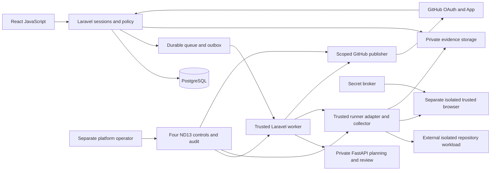

# DevGuardAI MVP architecture

Status: PROPOSED, 2026-10-27. Companion specification for MVP_TASKS.md. Existing code is a reuse candidate, not proof this architecture exists. Preserve the original Engineering Blueprint and approved PRD policies.

## Components and trust boundaries

Laravel owns current identity, tenancy, target consent, resource policy, budgets, job state, approvals, credit transactions and GitHub publication. FastAPI receives only bounded sanitized authorized data; it returns structured recommendations. It has no direct permission to mutate repositories, grant quotas or publish PRs. Customer scripts, package installation, build/test tools and patch verification run exclusively in vetted external managed isolation, never in trusted Laravel/FastAPI processes. Customer HTML/browser code also crosses an isolation boundary. A CLI sandbox used by the implementation engineer is a separate developer control and does not establish product runner isolation.

Use existing PHP ^8.2/Laravel ^12.70.1, React ^18.3.1/Vite ^5.4.2 and FastAPI manifests as inspection facts, not validated supported version commitments. Pin supported versions/lockfiles after approval; Python currently has broad minimum-only dependencies. PostgreSQL is required for meaningful concurrency validation; SQLite-only tests cannot certify transactional behavior. Queue/storage/model/vault/email/provider choices remain subject to approval; one provider per necessary capability first.

## Logical data and integrity

Reuse after review: User, Workspace, Membership, invitations/transfers, AuditEvent, Artifact/access links, CredentialAccount/Lease, CreditAccount/Reservation/LedgerEntry, Repository/Installation, Scan/TestResult. Add narrow focused records under existing domains rather than building a second application.

| Proposed record | Essential identity and invariant |
|---|---|
| Project / TargetAuthorization | Workspace, repository binding, target origins/environment/actions, proof/expiry/revocation; repository access does not prove website authority |
| ExecutionScope | Immutable workspace/project/repository/SHA, targets, capability/policy versions and budget; membership/consent remain live checks |
| JobAttempt / JobEvent / RunnerLease | Logical scan, generation/fencing token, sequence, observed stage, heartbeat, terminal result and cleanup outcome |
| ProviderInbox / EffectIntent / Outbox | Provider delivery/body fingerprint, durable command intent and logical remote-effect identity; unique constraints prevent duplicate effects |
| Finding / EvidenceReference | Source/rule/assertion, severity, file/line or target, observed versus AI judgment, sanitized artifact ID and provenance |
| FixPlan / FixJob / Approval | Version/digest, exact base SHA and file scope, enumerated jobs, budget/credit count, approving current Owner/Admin and expiry/revocation |
| VerificationResult / PullRequestEffect | Patched revision digest, actual checks, publication intent, GitHub branch/PR identity and reconciled external state |
| Notification / DeliveryAttempt | Actual event, current eligible recipient, preferences, dedup key and safe link; no private artifact attachment |
| UsageObservation / RecoveryRecord | Actual tokens, runtime, cost source, cleanup/restore evidence and uncertainty; proposed prices are not measured costs |

Tenant-owned records carry workspace identity and validated parent relationships. A scan's result/artifact must belong to the same scan and workspace; opaque IDs alone provide no authorization. Unique constraints cover provider delivery IDs, logical operations, credit effects and PR publication intent. Approval snapshots do not freeze authority. Secret payloads and complete private checkouts never enter queue messages or ordinary persistent records.

## Proposed HTTP contracts

Paths are proposals unless explicitly noted as existing. Use same-origin session cookies, CSRF on browser writes, explicit request validation, rate limits, bounded pagination and safe machine-readable errors. OAuth state remains enabled. Current `/workspaces/{workspace}/...` route naming can be preserved.

| Interface | Request → response | Authority/effect |
|---|---|---|
| Existing `/auth/github/redirect`, `/callback`, POST `/logout` | Socialite flow → session; regenerate/invalidate session | Stable GitHub ID; no App repository permission inferred |
| GET `/api/session`, `/workspaces` | Current user and permitted workspace summary | Authenticated read; replaces UI dependency on demo login |
| POST `/workspaces/{w}/github/installations/complete` | Server-correlated installation flow → verified binding | Current permitted actor plus provider authority; never trust submitted installation alone |
| Existing repository collection GET/POST/DELETE | Selected provider repo ID → connected/disconnected record | ND01 connection permission; no checkout or credit effect |
| `/workspaces/{w}/projects`, `/projects/{p}/targets` | Validated metadata/target proof → project/authorization | ND01 project settings; separate target consent and action policy |
| Existing scans POST/GET, scan GET | project/commit/target refs + Idempotency-Key → 202 queued run or denial; paginated actual results | Current StartScans/ViewScanResults; reserve once; no synchronous shell call |
| GET `/workspaces/{w}/scans/{s}/events?after={seq}` | Ordered durable events and next cursor | Current read permission; bounded polling/reconnect, no fake timer stages |
| POST `/workspaces/{w}/scans/{s}/cancel` | Versioned cancellation intent → observed state | Actor's cancel-own grant or approved operator control; no assumed remote cancellation |
| Existing artifact link/content routes | Artifact ID → revocation-aware short-lived authorized access | Validate current membership, scan/workspace ownership, expiry and lifecycle |
| POST `/workspaces/{w}/scans/{s}/fix-plans` | Explicit finding IDs → immutable grouped plan | Propose permission only; no code write |
| POST `/workspaces/{w}/fix-plans/{p}/approvals` | Plan digest/base SHA/file jobs/budget → approval and queued jobs | Current Owner/Admin; exact scope, no broad boolean approval |
| GET `/workspaces/{w}/fix-jobs/{j}` | Actual status/verification/handoff/PR link | Current resource authorization |
| GET `/workspaces/{w}/usage`, `/notifications` | Used/reserved/remaining/reset and safe event links | Current role/resource policy; server-derived accounting |
| Existing POST `/webhooks/github` | Raw signed body/delivery/event → durable inbox receipt | Provider authentication, size limits, replay/body conflict detection; no browser session or broad CSRF exemption |
| Private POST FastAPI `/internal/review`, `/internal/plan`, `/internal/fix-proposal` | Scoped bounded sanitized DTO → schema-valid judgment/plan/patch proposal | Workload authentication, request scope and timeout; no public wildcard credentialed CORS |
| Private runner observations | Scope/attempt/generation/sequence/digests → validated observation | Short-lived scoped workload identity, replay protection; collector control channel, not arbitrary runner access to trusted API |

400/422 invalid input, 401 unauthenticated, 403 denied, 404 safely concealed/missing resource, 409 stale scope/idempotency conflict, 429 quota/rate denial, 503 unavailable provider/control state are proposed error distinctions. Quota errors disclose only authorized usage. Decide exact envelopes in MVP-01.

## Execution and result flows

1. Login establishes identity; workspace membership establishes permissions. App installation separately establishes repository consent. Connect stores provider-confirmed metadata without executing customer code.
2. Scan admission rechecks membership, selected repository/install authority, SHA, target permission, supported capability, independent emergency controls and approved ceilings. Transactionally create scope/run/reservation/outbox. Identical logical request returns the same run; conflicting reuse is rejected.
3. Worker rechecks current authority before dispatch; claims generation-bound lease and provisions external isolation through the adapter. Credentialed checkout is a trusted phase with a short-lived selected-repository token. Remove token before untrusted scripts. No host credentials, Docker socket or trusted network access.
4. Discovery reads bounded metadata without executing it. Baseline commands run only after isolated policy validation. Trusted pinned scanners and Playwright consume declared capabilities. Repository scripts remain malicious inputs even when a manifest calls them tests.
5. Separate browser target scope restricts origins, redirects, DNS resolution and action types. Production uses reviewed non-destructive recipes; unknown actions are denied. Authenticated testing uses a separate trusted context and brokered test account only for a proven authorized environment.
6. Collector validates bounded output schemas, paths, MIME/size/checksum and scope/generation, sanitizes logs/text/screenshots and stores private job-bound evidence. Reject symlink traversal, archive bombs, executable HTML and invalid provenance. AI receives only approved redacted snippets/evidence; screenshot suppression is preferable where masking cannot be assured.
7. Durable stages follow Queued→Provisioning→Running→Analyzing→Finalizing→Cleaning→Completed. Failed/Cancelled/Partial/Blocked are explicit alternatives; tests failing can still produce a completed execution with failed assertions. Cleanup failure is separately visible, quarantines runner reuse and prevents claiming clean completion. Missing output, timeout, stale summary and unavailable AI never generate synthetic passes.
8. Finalize usage once under approved policy, preserving retries within the logical run; reconcile uncertain provider effects. Dashboard/Checks/report reflect actual coverage and outcomes. Notifications are permission-aware projections and do not change job success.
9. Fix proposal grants no write. Approved exact jobs reserve independent Fix credits; current consent/control state is rechecked before patch, verification and publication. Apply in fresh isolation, reject out-of-scope paths/binaries/workflows/secrets as configured, verify regression and original failure on the exact patched revision. Bounded retry consumes the same logical Fix reservation. Failure yields private handoff; success permits only the approved Draft PR.
10. Scoped publisher revalidates base SHA, installation, approval and GitHub-write switch immediately before each effect. Use unique branch/effect intent and compare-and-swap preconditions. On lost acknowledgment, query/reconcile before retry; never create duplicate branches/PRs or assume cancellation.

## Security and emergency architecture

Enforce all SG-01–SG-12, not just basic scanning. Basic scanners are a product feature; they do not certify DevGuard's own security. ND13 has independent controls for new scans, AI Fix, GitHub writes and runners. Current trusted policy is checked at admission/dispatch/action; unavailable control state denies dangerous boundaries. Authorized platform operators are separate from workspace Owners. Contain unsafe active work while preserving trusted evidence delivery, cleanup, quota reconciliation and incident audit; already submitted external writes require observed-effect reconciliation. Resume only after authorized incident review and current-policy revalidation.

Network policy is phase-specific and enforced outside repository control: prevent internal/private/loopback/link-local/metadata destinations, IPv4/IPv6 tricks, redirects, rebinding, WebSockets and alternate protocols; default deny other destinations. Source archive parsing and static scanners also process adversarial data. Cap CPU/memory/disk/processes/runtime/browser/model tokens/output volume and workspace concurrency. No unsafe fallback when provider/security controls are absent.

Reuse encrypted private artifact/broker components only after integration review. Existing string replacement does not prove image redaction or arbitrary secret detection. Keep report retention uniform where paid policy eventually applies; approve actual retention/link/lease lifetimes. Revocation-aware downloads remain authorized at retrieval; no public screenshot folders, provider token URLs, raw console dumps or sensitive email bodies. API and worker logs use safe correlation IDs.

## Development and deployment proposal

Implementation starts only after separate owner authorization and MVP-01. Preserve the dirty workspace; use an explicitly approved isolated baseline, not a worktree that silently drops untracked foundations. First verify installed toolchains without setup scripts. Dependency installation, migrations, tests and remote writes require their respective authorization. No deployment is performed by this plan.

Prefer a single trusted Laravel API/worker deployment, a private FastAPI service, PostgreSQL, durable queue, private storage and secret broker, static React assets and external managed isolated runner/browser. Same-origin routing reduces session/CORS complexity. Managed service versus self-managed choices and spending remain undecided. Development can use approved fixtures and contract fakes; real provider evidence is separately labeled and mandatory before real execution capability is accepted. Existing LocalDevelopmentModePolicy permits local/testing and synthetic evidence only: approve a distinct real-evaluation mode/evidence contract before provider-backed runs; do not relabel real runs as synthetic or flip the production flag.

Future delivery gates require protected secrets, least-privilege service identities, migration backup/rollback, queue draining/fencing, pinned images/tools, private staging targets, restore drills, telemetry and operator runbooks. Actual customer execution remains blocked until provider approval and isolation/SSRF/cleanup evidence exist. Public commercial deployment requires a separate plan and all original release obligations.
