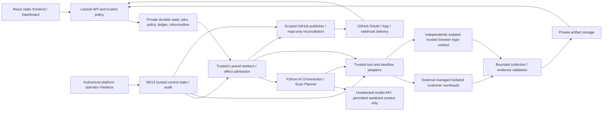

# DevGuard AI R1 Engineering Blueprint

**Status:** Proposed engineering architecture for review under T00/T01; documentation only. Approved product policy is binding, but the API shapes, logical entities and engineering mechanisms below have not been implemented or validated. This blueprint supplies architecture contracts to refine through the existing implementation plan; it creates no new work package, test case, provider commitment or product decision.

**Authority:** [PRD v4.3](../../product/PRD-v4.3.md), especially approved ND01 §3.1.1, approved ND13 §3.5.1 and Runtime QA §3.8; [master acceptance plan](../tests/devguard-master-test-plan.md); [implementation plan](../plans/devguard-implementation-plan.md); [AGENTS.md](../../../AGENTS.md). Remaining policy decisions stay in the [decision register](../plans/devguard-pending-decisions.md). These sources override any conflicting architectural proposal here. The root PRD copy is not the authoritative current baseline.

**Conventions:** “Required” describes an existing approved requirement. “Proposed” describes a reviewable engineering choice, not a claim that an endpoint/table exists. BA-01–BA-10 identify unverified architectural mechanisms in §12. ND/QTD identifiers retain their source meanings. All cited acceptance cases remain **SPECIFIED / NOT EXECUTED**.

## 1. R1 architecture and service boundaries

R1 includes the secure Web scan/report and approval/fix/Draft PR slices, basic team authority, commercial and operational hardening, and available Web/shared Runtime QA. React/Vite and vanilla JavaScript are the initial customer profiles. R2 API/Full-Stack, R3 customer-AI evaluation, R4 mobile and R5 Desktop are metadata-only PLANNED entries here; their providers, adapters, benchmarks and versions do not gate R1.

**Proposed approach:** a modular Laravel control plane with durable asynchronous commands, a separate Python planning/orchestration process and external managed isolated execution. A synchronous-only request chain couples browser latency to long-running work; splitting every domain into an independent network service adds consistency/operational boundaries before they are justified. The modular asynchronous approach fits the approved hybrid hosting and existing work packages while retaining explicit ownership. Neither queue technology nor deployment topology is selected.

B01–B23 in §11 are logical architecture components, not 23 separately deployed services.

Arrows from workloads to collection describe bounded output flow, not permission for untrusted code to call trusted APIs. The collector/adapters must obtain outputs through an approved control channel; exact provider support remains BA-05/BA-06.

| Boundary | Responsibility and allowed authority | Forbidden authority |
|---|---|---|
| React frontend | Show actual permitted projects, stages, reports, budgets and approval requests through Laravel | Enforcing grants, supplying trusted tenant identity, claiming success or inventing progress |
| Laravel API/workers | Authoritative ND01 policy, current resource consent, immutable scope, job transitions, approvals, ledger, publication and emergency admission | Running customer scripts or accepting AI text as permission |
| Python Orchestrator | Read bounded authorized metadata, choose eligible QA instructions, propose tests/fix plans, request approved tools and analyze observed results | Direct database privilege to grant scope/credits, arbitrary shell execution, self-promotion of skills or approval of writes |
| Sandbox/tool adapters | Validate current execution capability; provision, contain, collect and clean isolated workloads; enforce phase/resource policy | Unsafe fallback to trusted hosts or inherited broad credentials |
| Isolated runner/browser contexts | Perform actual authorized build/lint/tests/browser/patch work and emit observations | Trusted-service/private-network access, other-tenant state or unapproved tools |
| Artifact/secret mediation | Scope private evidence collection/retrieval and credential delivery to approved consumers | Exposing vault/storage master credentials, test-account secrets to AI/repo scripts, or full-repository persistence |
| Operator and release workflows | Separately authorize emergency operations and reviewed skill/release admission | Treating workspace Owner/Admin as platform operators, or emergency authority as automatic skill-publishing authority |

The trusted PostgreSQL/data, queue, storage and secret-service choices remain subject to ND06/ND15. There is no infrastructure deployment plan or purchase in this blueprint.

## 2. Logical database model and relationships

These are proposed domain records and keys, not migrations or a final physical table count. Opaque identifiers, schema normalization, transactional isolation, concurrency primitives and any database-native tenant controls require BA-01/BA-03 validation.

| Domain records | Key relationships and integrity | Component |
|---|---|---|
| User, GitHubIdentity, Session | Stable provider identity links to one internal user; mutable email is not the ownership key; sessions have current revocation state | B01 |
| Workspace, Membership | Membership links user/workspace with exactly one approved role and active/revoked state; prevent duplicate active grants and unsafe last-Owner removal | B01 |
| Invitation, OwnershipTransfer | Bind intended identity, approved proposed grant, inviter/current Owner and acceptance/confirmation evidence; pending state grants no workspace access | B01 |
| GitHubInstallation, WorkspaceRepositoryBinding, Project | Stable GitHub repository/installation identities link to authorized workspace projects; installation visibility alone is not workspace authority | B05 |
| TargetAuthorization, CapabilityProfile | Bind permitted live/staging target, environment actions, version/capability and current consent; repository consent is distinct from target consent | B07/B20 |
| ExecutionScope, ScanRun, JobAttempt, RunnerLease | Run pins workspace/project/repository/SHA, targets, capability/policy/budget versions; attempts and leases belong to that logical run and carry fencing identity | B10/B06 |
| JobEvent, CancellationRequest | Ordered durable events and actor-owned cancellation requests link to run/attempt; deduplicate events and serialize terminal decisions | B10 |
| Finding, FixPlan, FixJob | Findings refer to actual assertions/evidence; immutable plan version groups explicit scoped jobs with file/commit/budget identities | B13/B16 |
| Approval, ApprovalJobBinding, VerificationResult | Current Owner/Admin approval binds exact workspace/repository/commit/file set/plan/budget and enumerated jobs; verification identifies the patched revision | B13/B14 |
| CreditAccount, EntitlementPeriod, Reservation, LedgerEntry | Separate Scan/Fix account kinds per workspace; reservation and immutable effect identity bind one logical operation and its policy/period; ND03 decides period/settlement semantics | B03/B15 |
| ProviderInbox, CommandOutbox, EffectIntent | Inbound delivery identity and body fingerprint; durable local command intent; separately reconciled remote/provider effect identity and observed result | B11/B14/B15 |
| ArtifactRef, SecretRef | Job/workspace-bound private artifact metadata and broker references; no plaintext secret in domain records, job payloads or evidence | B02/B12 |
| SkillVersion, SkillCapabilityBinding, SelectionRecord | Immutable reviewed version/digest and compatibility; selection binds run/profile/task/policy and exclusions; no customer-content publication authority | B08/B09 |
| BenchmarkVersion, QualityReview | Dataset/label/holdout identities and independent version/profile-bound admission evidence; absent criteria/evidence cannot admit production use | B22 |
| EmergencyPolicyVersion, OperatorGrant, Incident, AuditEvent | Platform authority is separate from Membership; record switch state/scope/order, operator, impacted jobs, containment and recovery | B17 |
| NotificationPreference, DeliveryIntent, DeliveryAttempt | Current workspace recipient authority and preferences link to an actual event; delivery failures do not change job/ledger outcomes | B19 |
| UsageObservation, CostObservation, RecoveryRecord | Actual attempt/skill/provider usage, unit/currency provenance, restore/rollback observations and uncertainty; no proposed price becomes measured cost | B21/B17 |

Required relationship protections:

- Every tenant-owned child record carries a trusted workspace relationship; parent/child foreign references must not permit mixing A's job with B's artifact, approval, reservation or repository. Application authorization remains required even if database constraints are added.
- Scope, approval and manifest fingerprints are immutable for an attempt. Membership, consent, policy and control state remain live checks; a snapshot is evidence, not permanent authority.
- An approval-to-job relation enumerates jobs rather than authorizing all future findings. One plan can have several separately accountable explicit Fix jobs.
- Invitation acceptance proves intended identity and an authorized pending grant; it does not treat the invitee as already entitled to project data. Confirm bootstrap and revocation races under BA-01 without weakening ND01.
- A restored, cached or soft-deleted record must not silently reactivate consent or authority. Financial/audit and report retention are independent under ND05.
- Uniqueness constraints protect logical effect identities; transactions and external-effect reconciliation are distinct (§9). Exact indexes/locking are not approved here.

## 3. API contracts and authorization boundaries

### 3.1 Shared contracts

**Proposed ExecutionScope:** server-issued scope identity; workspace and project; initiating user or validated automation authority; repository/App binding and pinned commit; separately authorized target/environment/actions; selected Scan/Fix profile; approved budget-policy reference; plan/approval references when applicable; policy/capability revisions; trace identity. Caller-supplied workspace IDs, booleans or claimed roles never establish these facts.

**Proposed Command:** command identity and logical operation identity; action and immutable scope reference; request fingerprint and idempotency identity; intended attempt/generation; correlation and causation identities. A queue message carries references, not secrets, an unbounded shell command or a permanent authorization grant.

**Proposed Observation:** run/attempt/assertion/sequence identities; actual source/profile/skill/digest/tool/model/runner/dataset provenance; deterministic outcome or separately labeled AI judgment; artifact references; consumed resources; exclusions/errors. Treat all worker observations as untrusted inputs requiring schema, scope and provenance validation.

**Proposed response/error envelope:** operation/resource ID, actual state/version, correlation ID, permitted evidence links and a machine-readable reason with safe detail. Distinguish invalid scope, denied authority, stale approval/revision, exhausted quota, unavailable capability, emergency denial and retryable infrastructure failure. Status codes, pagination, stream transport, identifier format and wire versioning are BA-01/BA-02 choices, not existing APIs.

### 3.2 Proposed endpoint families

Paths below are design contracts for review. They neither describe implemented routes nor amend ND01.

| Contract family | Essential request/result | Authorization and effect boundary | Component |
|---|---|---|---|
| GitHub OAuth redirect/callback; logout | Request-bound OAuth state/session; validated stable GitHub identity; rotated/revoked session | Laravel Socialite GitHub-only login; App installation does not authenticate a user; browser mutation/CSRF protections must be validated | B01 |
| GET /workspaces/{w}/projects and /reports/{id} | Scoped list/detail with actual coverage and private links | All four roles only with active membership and resource authority; filter before returning data | B01/B16/B18 |
| POST /workspaces/{w}/repository-connections | Selected installation/repository identity; resulting connection | Owner/Admin plus current GitHub permission; connection alone does not clone, start a runner or reserve credit | B05 |
| PATCH /projects/{id}/settings | Versioned settings/authorized automation scope | Owner/Admin; resource and consent validation; changing scope cannot preserve stale execution approval | B01/B05 |
| POST /workspaces/{w}/scans | Project, pinned source, authorized targets/profile and idempotency identity; logical run/state | Owner/Admin/Member; current policy, capability, emergency controls, budget and atomic quota admission | B10 |
| GET /jobs/{id}/events | Authorized cursor and durable ordered state/events | Current membership/resource authority on connect/reconnect/history; stream is not an authorization cache | B10/B18 |
| POST /jobs/{id}/cancel | Own-job cancellation intent; actual resulting state | Owner/Admin/Member for own jobs under safety policy; Viewer and unspecified other-job grants denied; financial outcome remains ND03 | B10 |
| POST /runs/{id}/fix-plans | Finding identities and bounded non-mutating planning request; immutable proposed plan | Owner/Admin/Member; no patch or PR write from plan creation; planning budget policy remains ND04 | B13 |
| POST /fix-plans/{id}/approvals | Exact plan/version/jobs/commit/files/budget; approval and admitted explicit Fix jobs | Owner/Admin only; bind every RBAC-12 field and revalidate before execution; no automatic scope widening | B13 |
| POST /fix-jobs/{id}/unverified-review-approvals | Separate informed approval for a screened human-review-only Draft PR | Owner/Admin only; original Fix approval cannot substitute; failed security screening still denies publication | B14 |
| POST /workspaces/{w}/invitations and role/transfer commands | Intended identity and allowed role; acceptance/confirmation proof; protected result | Approved ND01 action matrix, no self-escalation, Admin cannot appoint Admin/Owner, accepted transfer and last-Owner protections | B01 |
| POST /workspaces/{w}/subscription-changes; sensitive settings/deletion commands | Owner-authorized, disclosed policy-bound intent | Owner only; verified provider events independently authenticated; no guessed proration, price, retention/deletion or paid continuation rule | B15/B01 |
| Provider webhook ingress | Authentic delivery bytes/identity; durable receipt and later processing state | Provider-specific authentication and binding, not a browser/user role claim; acknowledgment is not execution success | B11/B15 |
| Platform emergency activation/resumption commands | Named control, incident/scope, operator identity and reviewed recovery evidence | Separately authorized platform operator; dangerous execution gates recheck actual trusted state; no workspace-role inheritance | B17 |

Internal Python/tool/sandbox calls use authenticated scoped service identities; exact transport and capability format are BA-02/QTD-02. There is no public execute-shell, arbitrary tool, credit adjustment, skill publication or merge endpoint. Unknown actions remain denied.

For automatic scans, service authority must be derived from an authorized opt-in workspace/repository/branch grant and current policy; a webhook actor name is not a workspace membership. T01 must validate grant continuity when the authorizing membership changes (BA-01/BA-02). Billing ingress similarly verifies provider identity and the entitlement contract rather than trusting an “Owner” field.

## 4. Scan and AI Fix execution lifecycles

### 4.1 Scan

1. Resolve current authority and source/target scope. Read metadata without executing repository hooks; record confidence and capability exclusions. Connecting a repository alone does not start this flow.
2. Resolve eligible R1 capabilities and QA versions (§7). Validate actual budget/profile configuration; unknown provider, capability, required limit or trusted emergency state blocks dangerous admission rather than supplying a default.
3. Atomically create or identify the logical job, its permitted reservation and durable dispatch intent (§9). A retried request returns the permitted existing identity only after current read/action authorization.
4. Before provisioning/dispatch, revalidate membership/delegation, repository consent, pinned revision, target/environment permissions, relevant switches, quota reservation and budget. Acquire one current attempt/lease; uncertain previous provisioning is reconciled before replacement.
5. Emit real Queued → Provisioning → Running → Analyzing → Finalizing → Cleaning transitions as those activities occur. Real baseline checks precede or accompany feasible scoped browser work; optional trusted login is separately brokered.
6. Validate/sanitize observations, keep deterministic assertions separate from AI hypotheses, and persist actual coverage/provenance. Missing login/staging/techniques can yield useful authorized partial coverage.
7. Finalize truthful Completed/Failed/Cancelled/Partial/Blocked outcome only with actual observations and cleanup disposition. Quarantined residual resources cannot be reassigned. Cancellation/completion races yield one durable coherent terminal decision; exact transition arbitration/ordering is BA-03.
8. Reconcile ledger effects under ND03, then update scoped reports, Checks and Dashboard/Email delivery intents as permitted. Notification failure does not change the scan outcome.

A Scan's orchestration completion is distinct from its test verdict: a finished scan can contain failing assertions. No measured percentage is invented. Live deployed SHA remains unknown unless ND10 attribution is actually established; source SHA and observed live target are not falsely equated.

### 4.2 AI Fix

1. Group actual findings into a non-mutating plan identifying repository/commit, workspace, files, risks, environment, explicit jobs and budget/credit disclosure.
2. Obtain current Owner/Admin approval bound to the precise plan/scope. Reserve the approved jobs' independent Fix entitlement; a bundle is not an open-ended job allowance.
3. Recheck scope and AI Fix/Sandbox controls before the first source modification, including isolated patch creation. Python may request tools; it cannot approve itself.
4. Perform the patch in the isolated authorized context. Reject out-of-file/base/plan/budget changes; changed scope or stale authority needs fresh explicit approval.
5. Run the appropriate actual patched-revision checks and security/secret screening. Record attempt provenance; retries and verification stay within approved ND04 bounds and add no Fix credit.
6. Publish a verified Draft PR only when actual verification and current consent/approval/switch checks permit. Recheck both AI Fix and GitHub Write immediately before a Fix-related remote submission and every retry; verification and approval do not bypass a disabled control.
7. On failure or unavailable/partial verification, produce a sanitized handoff. Only a separate informed Owner/Admin approval can permit a screened, plainly unverified human-review-only Draft PR. Unsafe content remains unpublishable even with approval.
8. Reconcile uncertain remote effects, cleanup and ND03 financial settlement. An executed unsuccessful Fix counts under PD-017 except approved platform-error handling; never infer a refund or re-bill an internal retry. Never merge or enable auto-merge.

## 5. GitHub integration and webhook/effect handling

Authentication (OAuth), repository authorization (GitHub App installation), event authenticity and permission to write a particular approved effect are separate checks.

**Proposed inbox/outbox flow:** verify the provider contract and repository/account binding → durably accept an inbox record with delivery identity/body fingerprint → asynchronously resolve opt-in/branch/SHA/current scope → admit a logical command and ledger reservation where required → create scoped Check/comment/PR intents → revalidate at publisher → record provider result or uncertainty → reconcile.

- Bound and authenticate inbound bytes before business processing; persist only required private receipt/body-fingerprint data under reviewed ND05 lifecycle/access controls, never dump webhook bodies or credential headers into general logs.
- Verify signatures and applicable replay controls against the actual reviewed provider contract. Do not invent a GitHub timestamp field or assume all providers implement identical replay/idempotency behavior (ND06).
- Duplicate delivery is an inbox replay; reordered events must not regress job/installation/financial state. Manual-versus-automatic logical-run coalescing remains ND03; same SHA alone does not decide it.
- Resolve current installation/repository identity and permission on checkout and writes. Uninstallation/revocation, transfers, branch rename/deletion and stale SHA produce truthful denial/skipped/blocked state.
- GitHub Check/summary status reflects actual execution/coverage, never a successful scan when permission, quota, capability or emergency control prevented it.
- Diff comments are automatic, nonblocking, deduplicated and grounded in current valid changed-line evidence. This PD-021 exception does not approve source changes or fix PR publication.
- Outbound intent records bind effect type, repository, commit/diff, approved scope, logical identity and observed provider ID. A lost acknowledgment creates an uncertain effect, not proof of failure or permission to POST again.
- Reconcile remote state using permitted reads; a disabled GitHub Write switch still prevents new mutation. If the actual provider contract cannot resolve ambiguity safely, preserve the uncertainty and escalate rather than claiming universal exactly-once delivery.
- Rate limits/outages use bounded approved recovery policy with backpressure and truthful state. No provider retry duration/maximum is selected.

## 6. Sandbox isolation and credential management

The provider-agnostic contract covers detect/plan/validate/execute/collect/cleanup with explicit capability/result metadata. T25 selects no provider through this blueprint; T06/T21 must obtain actual isolation and lifecycle evidence.

**Proposed execution admission:** current scope and consent + eligible runner/profile + fenced attempt + budget reference + phase-specific network/filesystem policy + relevant emergency state. The adapter accepts typed operations; it does not relay arbitrary unvalidated model commands.

Required defenses are enforced beneath prompts: tenant/workload filesystem/process isolation, no trusted-service reachability, ephemeral checkout, bounded CPU/RAM/process/disk/wall-time/AI/browser/concurrency, and controlled phase-specific egress. Connection-time resolution must cover private/local/link-local/metadata/IPv4/IPv6, redirect and DNS-rebinding attacks. Approved setup/target traffic must remain usable without unrestricted internet. Exact enforcement primitives, network destinations, images and bounds remain ND04/06/07 and BA-05.

**Credential compartments:**

- OAuth/App/provider credentials stay in trusted services or approved brokers. A trusted fetch compartment in the external execution pipeline receives only the minimum approved repository-specific checkout capability; it delivers the ephemeral worktree without exposing the App/user token to repository scripts, their environment or mounts.
- Test-account credentials go only to a trusted login consumer, not AI, arbitrary repository commands, their environment/filesystem/process namespace, logs or raw evidence.
- A credentialed Playwright context must be independently isolated from hostile repository scripts; “both are in a sandbox” is not proof of separation. Its session/cookie/storage/download lifecycle is private and job-scoped (BA-06).
- Preferred collection candidate: adapter/supervisor-mediated retrieval through an approved provider control channel, validation of allowlisted artifact paths/size/provenance, sanitization and private storage. No raw untrusted workload obtains broad storage/secrets credentials or arbitrary Laravel/Python network access. Validate this channel before relying on it.
- Secret references and delivery leases are scoped and revocable; actual expiry, rotation, link lifetime, encryption/key controls and retention remain ND05/06. Credentials never become shared benchmark fixtures.
- On failure/cancel/crash/containment, collect safe observations, revoke scoped access and clean or quarantine residual resources. Repository cleanup hooks remain untrusted; no unsafe host fallback or cross-tenant reuse.
- Guided login uses sanitized selectors/flow evidence and review as needed; trusted verification establishes actual coverage. CAPTCHA/MFA is not bypassed.

## 7. Expert QA Skill Registry and selection

The full thirteen-capability catalog and manifest requirements are canonical in PRD §3.8; they are referenced rather than recopied here. Codex development Skills guide building DevGuard. Runtime QA Skills guide its Python Orchestrator. Actual frameworks and isolated runners execute tests.

**Proposed registry separation:**

1. Reviewed immutable SkillVersion records contain identity/digest/provenance, compatibility, tool/input/output/evidence/budget contracts and benchmark bindings.
2. CapabilityProfile bindings declare platform/task/release/version and independent Scan/Fix status; later profiles stay PLANNED.
3. QualityReview records bind independent behavioral evidence and permitted production profile. Registration is not promotion.
4. SelectionRecord pins the run's chosen versions, risk/technique reasons, policy/profile identities and explicit exclusions.

Selection starts from trusted scope and discovery, filters compatible reviewed R1 capabilities, intersects tool needs with current policy and budgets, then chooses feasible risk techniques. Model/repository text cannot publish a version, change support status, grant a tool or make an incompatible version runnable. Unsupported suggestions remain explicit exclusions.

The tool broker revalidates the permission intersection at the actual boundary (§3/§8); selection is not an authorization cache. Responses distinguish deterministic outcomes, AI judgments and hypotheses. Every finding retains observed evidence and uncertainty; unsupported diagnoses are unverified rather than confirmed defects.

T33 requires independent clean/known-defect/holdout datasets, integrity/provenance/privacy checks, separately measured FP/FN, budget/failure/injection checks, reviewed regression criteria and compatible rollback evidence. Thresholds/sample requirements and distribution/integrity formats remain QTD-01–QTD-04. No syntax-only or model self-evaluation admits production use.

Rollback selects a previously reviewed compatible version under current policy for a new or explicitly identified attempt; it does not overwrite in-flight provenance or restore revoked privileges. R1 skill-quality benchmarks are distinct from ND08's R3 customer-AI evaluation dataset. Accessibility diagnostics do not approve an ND09 conformance standard. No new development Skill is necessary for this blueprint; future demonstrated gaps use the existing writing-skills/independent behavioral verification process.

## 8. ND13 enforcement boundaries

Approved KS-01–KS-10 and ND01 are unchanged. Only authorized platform operators activate/resume controls; workspace roles, model text and queue claims never confer this authority.

| Independent control | Last trusted dangerous boundaries | Safe activity that remains possible |
|---|---|---|
| Scan | Manual/automatic admission and queued scan dispatch; affected execution requests | Authorized reads, incident audit, truthful reporting and safe reconciliation/cleanup |
| AI Fix | Fix admission, first patch action, each patch retry, Fix-related Draft PR publication and continued unsafe Fix work | Sanitized read-only handoff and safe cleanup/reconciliation; no unapproved source write |
| GitHub Write | Check/summary/comment/Draft PR mutation submission and every publication retry | Permitted provider reads and reconciliation of already-submitted effects |
| Sandbox/Runner | Provisioning, workload start and unsafe continuing runner operations | Trusted teardown/quarantine/reconciliation outside customer hooks |

Effective admission applies every relevant control: enabling Scan does not bypass a disabled runner, and re-enabling one control does not alter another.

**Proposed enforcement mechanism for validation:** one authoritative versioned emergency policy, durable incident/control ordering, scoped execution generations and a trusted final effect-admission broker. A stale UI flag, cached worker decision or earlier queue acknowledgment is insufficient. The actual design must establish the activation/effect ordering point and fence concurrent/restarted workers at the final boundary (BA-08); a version label alone is not a correctness proof.

After activation, new affected effects are denied; unsafe in-flight work is cancelled, isolated or quarantined. Already-submitted requests are recorded and reconciled, not presumed cancelled. Unknown trusted switch state fails closed for dangerous operations. Safe trusted maintenance continues only under its own current authorization; classifying an arbitrary script as cleanup grants no exemption.

Resume requires authorized incident review, verified remediation, current membership/resource/App/approval/quota/budget/capability checks and applicable trusted control state. Reconcile credit reservations idempotently under ND03. Record operator, scope, impacted jobs, containment, remote outcomes, denied attempts and recovery without secrets. T01 specifies mechanisms, boundary tasks enforce from the first working path, and T18 verifies integration.

## 9. Credit ledger, transactions and idempotency

### 9.1 Fixed invariants versus unresolved policy

Required: separate workspace Scan/Fix ledgers, atomic reservations, no negative available credit, one bounded logical full Scan regardless of internal test/skill count, individually accountable approved Fix jobs, no extra Fix credit for internal retry/verification, and no automatic overage/purchase. Existing approved entitlements remain in the PRD; no commercial number is chosen here.

**ND03 is unresolved.** This blueprint does not choose cancellation charging, the charge/settlement boundary, platform-error refund/restoration rules, reservation expiry, reset/timezone/calendar rules, old-period in-flight settlement, or manual/automatic logical-run coalescing. ND02 upgrade arithmetic, ND04 retry/resource limits and ND11 real-user trial eligibility are also unresolved.

### 9.2 Proposed durable mechanism

Within one authoritative data transaction: validate the approved policy/period and available account, identify/reuse the logical request, reserve permitted credit, create job/scope and dispatch-outbox intent, then commit. If it cannot commit, no funded dispatch intent becomes executable. Exact locking/isolation/constraints require BA-03; this specifies the atomic boundary, not a chosen SQL primitive.

The dispatcher delivers an intent under the current attempt/lease and revalidates policy and emergency state. Record actual execution/remote facts independently from financial interpretation. A crash leaves reconciliation work rather than an inferred free retry or a second charge. Ledger effects are immutable; corrections use attributable compensating effects linked to the original identity, with policy-defined values.

Proposed reservation states are HELD, RESOLUTION_PENDING and policy-resolved SETTLED/RELEASED. Which transition consumes/restores credit and at which observed boundary requires ND03. Cleanup completion and billing settlement are distinct facts; ledger unavailability cannot justify duplicate execution or an invented terminal credit result.

| Idempotency domain | Proposed identity and collision handling | Still unresolved |
|---|---|---|
| Interactive command | Workspace + initiating authority + action + client key, bound to immutable request fingerprint; same key/different payload conflicts and replay rechecks authority | Wire format, retention/expiry and any cross-trigger coalescing |
| Webhook receipt | Provider + verified account/installation scope + delivery identity, bound to received-body fingerprint | Actual provider replay fields/rules under ND06 |
| Logical execution | Server-issued operation identity with fenced attempt/dispatch generation; delayed/duplicate claims cannot start unaccounted work | Lease, fencing and uncertain-provisioning protocol BA-02/BA-03/BA-05 |
| Ledger effect | Account kind/workspace + logical operation + stable server-issued effect identity; policy version is recorded without allowing a policy-version change to duplicate that effect | ND03 amounts and transition semantics |
| Remote GitHub effect | Stable publication intent + exact repository/SHA/diff/effect scope; persist observed provider identity and uncertainty | Provider reconciliation capabilities; no generic exactly-once guarantee |
| Entitlement/trial | Authenticated provider-event identity and approved global trial-eligibility identity | ND02/ND03 period/upgrade arithmetic and ND11 qualifying real-user definition |

The outbox only makes local intent durable; it does not make a remote API and the database one transaction. Retry an uncertain external operation only after its supported reconciliation contract and current controls permit. Never deduplicate all manual/webhook requests solely by commit SHA.

## 10. Observability, audit, security and recovery

**Proposed telemetry contract:** correlate workspace, logical job, attempt, policy/control generation, scope/source/profile, skill/dataset/tool/runner, inbox/command/effect and incident identities. Record actual stage transitions, queue age, heartbeat/lease loss, denial reasons, cleanup/quarantine, missing evidence, provider uncertainty, resource usage and costs. Tokens, model calls, retries, sandbox/browser usage and fixed/trial overhead retain measured-versus-simulated provenance. No illustrative price, SLA or capacity is treated as observed.

Operational metrics must avoid secrets/private source and unnecessary high-cardinality tenant payloads. Logs, audit and evidence have distinct access/retention policies; ND05 remains unresolved. Audit authorization changes, invitations/ownership, precise approvals, denied privileged calls, platform control operations, publication and ledger reconciliation using attributable protected records. Audit durability/tamper detection and privileged access are BA-09 choices, not claims of an existing immutable log system.

Reports use real assertions and explicit partial/blocked/unsupported states; notification intents recheck recipient authority/preferences at delivery, with no Telegram or routine success-email spam. ND14 selects exact priorities/opt-outs/retry behavior. Client reconnect restores authorized event history; cached browser permissions never authorize a request.

Recovery design must cover worker crash, queue/database/cache/provider outage, uncertain runner provisioning, interrupted evidence upload/cleanup and financial/external effects. A restart cannot implicitly re-enable disabled or unknown emergency controls. Quarantine residual state before reuse.

**Proposed restore safety sequence:** isolate the restored system with dangerous execution/write admission closed → verify restored data and current authority/consent/control state → reconcile reservations and remote effects without blind replay → validate required cleanup/private evidence → authorized review and scoped resumption. If current authority or policy cannot be established from trusted records/provider facts, keep affected operations blocked. Exact recovery objectives, backup/checkpoint/rollback mechanisms and recovery evidence remain ND12/BA-09; no RPO/RTO is selected.

| Mandatory security area | Architecture check / existing evidence focus |
|---|---|
| SG-01 | OAuth/session integrity and stable identity; B01 |
| SG-02 | Current server-side membership/resource authority and tenant relationships; B01/B02/B10 |
| SG-03 | Provider authenticity, least privilege, scoped writes and uncertain-effect recovery; B05/B11/B14 |
| SG-04 | Real external isolation, no trusted-host fallback, private lifecycle/cleanup; B04/B06/B12 |
| SG-05 | Connection-time SSRF and phase-specific egress; B06 |
| SG-06 | Brokered credentials, isolated login consumer and sanitized evidence; B02/B12 |
| SG-07 | Precise pre-modification approval and separate unverified-review approval; B13/B14 |
| SG-08 | Untrusted-content containment across planning/registry/tools; B06/B09/B12 |
| SG-09 | Atomic ledger, authenticated entitlement events and bounded spending; B03/B15/B21 |
| SG-10 | Private scoped evidence, links and lifecycle; B02/B16 |
| SG-11 | Actual restoration/migration recovery and preserved current authority; B17 |
| SG-12 | Independent emergency controls, incident audit/runbook and reviewed recovery; B17/B23 |

All areas require actual scoped evidence before release; this mapping passes none of them. Runtime QA-014 evidence, critical/high remediation, sustainable measured operations, privacy/provider/legal validation, authorized pilot and explicit Go/No-Go remain required by T22.

## 11. Existing work-package and acceptance traceability

T00/T01 own source review and refinement of this architecture. The following are representative existing R1 links, not a replacement acceptance catalog or a new ownership assignment. The implementation plan retains canonical case owners; contributors can share integration evidence.

| Component | Architecture responsibility | Existing R1 packages | Existing acceptance IDs | Source constraints |
|---|---|---|---|---|
| B01 | Identity, workspace authority and membership | T02 | DG-IAM-006, DG-IAM-014, DG-IAM-017, DG-IAM-019, DG-IAM-020, DG-IAM-021 | PD-009/010; RBAC-MATRIX; RBAC-01–RBAC-15; SG-01/02 |
| B02 | Private artifacts and secret references | T03 | DG-REPORT-003, DG-REPORT-006, DG-REPORT-011, DG-REPORT-012, DG-REPORT-013 | PD-018/027; SG-06/10 |
| B03 | Separate Scan/Fix ledger | T04 | DG-CREDIT-001, DG-CREDIT-003, DG-CREDIT-004, DG-CREDIT-006, DG-CREDIT-012, DG-CREDIT-014 | PD-015/016/017; SG-09; ND03 |
| B04 | Trusted hosting/provider assurance | T25 | DG-HOST-001, DG-HOST-002, DG-HOST-003 | PD-025/037/039; SG-04/06; R1 providers only |
| B05 | Repository/App binding | T05 | DG-GH-001, DG-GH-002, DG-GH-005, DG-GH-010, DG-GH-015 | PD-009/020/033; SG-03 |
| B06 | Sandbox policy, budgets and lifecycle | T06 | DG-RUN-001, DG-RUN-003, DG-RUN-004, DG-RUN-009, DG-RUN-013, DG-RUN-016, DG-RUN-018 | PD-022–PD-027; SG-04/05/06/08 |
| B07 | Read-only discovery and capability profiles | T07 | DG-DISC-004, DG-DISC-006, DG-DISC-008, DG-DISC-009, DG-DISC-010, DG-DISC-011 | PD-004/007/029/041; SG-04 |
| B08 | Runtime manifest and version admission | T30 | DG-QA-001, DG-QA-002, DG-QA-003, DG-QA-004 | QA-001/003/004; QTD-01 |
| B09 | Registry selection and Scan Planner | T31 | DG-QA-005, DG-QA-006, DG-QA-007, DG-QA-008 | QA-002/007; PD-005/029 |
| B10 | Scan admission, dispatch and progress | T08 | DG-JOB-001, DG-JOB-003, DG-JOB-007, DG-JOB-008, DG-JOB-010, DG-JOB-011, DG-JOB-012 | PD-001/003/016/019; RBAC-11; KS-03 |
| B11 | Webhook inbox and GitHub effects | T09 | DG-GH-003, DG-GH-004, DG-GH-007, DG-GH-008, DG-GH-011, DG-GH-012, DG-GH-017 | PD-003/020/021; SG-03/06/09 |
| B12 | Real Web tests, brokered login and Runtime QA execution | T10, T23, T13, T32 | DG-WEB-006, DG-WEB-008, DG-SECRET-001, DG-SECRET-002, DG-AI-001, DG-QA-009, DG-QA-018, DG-QA-033 | PD-005/006/027/028; QA-005–QA-009/012/013; SG-04/06/07/08 |
| B13 | Fix Plan and precise approval | T14 | DG-FIX-001, DG-FIX-002, DG-FIX-003, DG-FIX-010, DG-FIX-011, DG-FIX-012, DG-FIX-013 | PD-008/017/030; RBAC-12; SG-07/09 |
| B14 | Fix verification, retry and Draft PR publisher | T15 | DG-FIX-006, DG-FIX-008, DG-FIX-014, DG-FIX-015, DG-FIX-016, DG-FIX-017, DG-FIX-019 | PD-002/008/020/031/032; SG-03/06/07/09 |
| B15 | Trial and commercial lifecycle | T16 | DG-BILL-001, DG-BILL-004, DG-BILL-007, DG-BILL-008, DG-BILL-011, DG-BILL-014, DG-BILL-017 | PD-014/015/035/036; SG-09; ND02/03/11/15 |
| B16 | Evidence-backed reports and history | T17 | DG-REPORT-001, DG-REPORT-002, DG-REPORT-005, DG-REPORT-008, DG-REPORT-009 | PD-012/029; QA-008/009 |
| B17 | Emergency enforcement, audit and recovery integration | T18, T06, T08, T09, T14, T15 | DG-REC-006, DG-REC-007, DG-REC-008, DG-REC-011, DG-REC-012, DG-REC-013, DG-REC-018, DG-REC-019, DG-REC-020, DG-REC-021, DG-REC-022, DG-REC-023, DG-REC-024 | PD-039; KS-01–KS-10; SG-11/12 |
| B18 | React Dashboard and approval experience | T19 | DG-UX-001, DG-UX-002, DG-UX-003, DG-UX-006, DG-UX-007, DG-UX-008 | PD-007/008/012/019/029/030 |
| B19 | Dashboard/Email delivery | T20 | DG-NOTIFY-001, DG-NOTIFY-002, DG-NOTIFY-005, DG-NOTIFY-007 | PD-011/034; SG-02; ND14 |
| B20 | Shared adapter contract and unsupported denial | T21, T06 | DG-PLAT-001, DG-PLAT-007, DG-RUN-012 | PD-024/041/042; SG-04; R1 contract scope |
| B21 | Measured usage, capacity and cost | T24 | DG-COST-001, DG-COST-003, DG-COST-004, DG-COST-005, DG-COST-006 | PD-038; SG-09; ND02/04 |
| B22 | Independent skill-quality admission | T33 | DG-QA-020, DG-QA-022, DG-QA-023, DG-QA-024, DG-QA-025 | QA-010/011/014; QTD-03; SG-04/06/08 |
| B23 | Release evidence review | T22, T33 | DG-GATE-001, DG-GATE-005, DG-GATE-006, DG-GATE-009, DG-GATE-010, DG-GATE-011, DG-GATE-012, DG-QA-034 | PD-039/040; QA-014; all SG areas |

R1 ordering remains the existing dependency graph: authority/privacy/ledger/provider/runner/discovery → T30/T31 selection → T08 and real Web planning/execution → T32 → approved Fix/report/commercial/operations → T33 → T22(R1). This shorthand adds no dependency edges and does not imply that independent tasks must be serialized.

The R1 gate has no ancestor in T11/T12/T26–T29/T34–T38. Later profile parameters on shared cases, including native lifecycle instantiations and composite accounting, are exercised for their later release rather than made R1 execution prerequisites. Repeat relevant report/recovery/cost/quality/security review for each later release's actual scope; no future platform result is claimed now.

## 12. Architectural assumptions, validation and remaining blockers

These BA records describe engineering validation work under existing tasks. They are not new ND policy approvals or additional work packages.

| Record | Proposed assumption / proof still required | Existing owner / gate |
|---|---|---|
| BA-01 | Logical entities and API families can implement ND01 exactly: identity/session/CSRF, authorized invitation bootstrap/expiry/revocation, ownership acceptance, last-Owner races, sensitive-setting classification and live revocation | T01/T02/T19; ND01 implementation validation |
| BA-02 | Durable command/observation contracts and authenticated scoped service identities prevent stale/forged Python/worker authority; automation delegation remains valid only under current approved workspace policy | T01/T08/T13/T32; QTD-02 |
| BA-03 | Data transactions, tenant relationships, event ordering, account uniqueness and attempt fencing prevent duplicate funded execution and inconsistent terminal decisions under crashes/concurrency | T01/T04/T08/T15/T18; ND03/ND04 |
| BA-04 | GitHub/payment provider contracts support verifiable receipt/binding, state reconciliation and safe uncertain-effect handling; actual permissions and retry/replay fields must be reviewed | T05/T09/T15/T16/T25; ND06/ND15 |
| BA-05 | Selected R1 external runner can enforce required host/tenant/resource/network/phase/lifecycle controls and safe collection; provider API metadata alone is insufficient | T06/T21/T25/T32; ND04/ND06/ND07 |
| BA-06 | Credentialed trusted browser and collection contexts can be isolated from hostile repo commands while preserving private job-bound authentication/evidence | T03/T06/T10/T23/T32; ND05/ND06 and QTD-02/QTD-04 |
| BA-07 | Registry integrity/distribution/version compatibility, independent reviewer authority, skill-quality datasets/thresholds and rollback can be proven for the exact R1 profiles | T30/T31/T32/T33; QTD-01–QTD-04 |
| BA-08 | Emergency state distribution, activation/effect ordering and operator authentication/fencing meet KS-01–KS-10 across concurrent workers, unavailable policy and restart; safe maintenance cannot become a bypass | T01/T06/T08/T09/T14/T15/T18; approved ND13 mechanisms |
| BA-09 | Private/tamper-resistant audit, backups/restore/migration recovery and current authorization/remote/ledger reconciliation are achievable and measurable | T03/T18/T25; ND05/ND12 |
| BA-10 | Progress/report/notification/cost contracts remain truthful under partial observations, event reordering, channel failure and tail usage without unapproved commercial defaults | T17/T19/T20/T24; ND02/ND04/ND10/ND14 and QTD-04 |

**R1 policy blockers:** ND02 commercial/upgrade/margin values; ND03 settlement/cancel/period/deduplication; ND04 budgets/retry/fair-use; ND05 privacy/credential/retention controls; applicable R1 ND06 providers/contracts and ND07 exact Web profiles; ND11 trial eligibility; ND12 recovery objectives; ND14 notification semantics; ND15 eligibility/geography/legal/provider review. These block their affected implementation/acceptance, not every independent architecture task. Actual cost measurements must inform the financial/budget decisions; none have been performed here.

**Conditional or later decisions:** ND10 blocks a verified deployed-SHA claim, not ordinary scans that explicitly retain unknown live attribution. ND09 stays supplementary and creates no new mandatory conformance gate. ND08 is R3-only. Future native provider/version/benchmark choices cannot block R1. ND01 and ND13 policy approval is complete; their mechanism validation remains BA work.

**Review handoff:** T01 must validate this proposed schema/API/effect design against the existing assertions and resolve relevant BA/QTD records before executable child plans lock interfaces or commands. Source requirements, real framework/runner evidence and separate implementation/test authorization remain necessary. No development Skill, runtime Skill, benchmark, provider or security control is claimed installed, independently behaviorally verified or deployed.

## 13. Documentation verification scope

Read-only checks for this artifact resolve its source links, every component/package/case reference and the representative canonical-owner mapping; inspect ND01/ND13 approval and the unchanged source dependency graph; ensure no later-release case is presented as an R1 execution prerequisite; and compare source hashes before/after creation. No acceptance case, work package, policy or source document is changed.

Document consistency is not execution evidence. The master catalog remains SPECIFIED / NOT EXECUTED, no application test is run, no package/provider is selected or installed, and no cloud resource, application scaffold or deployment is created.
